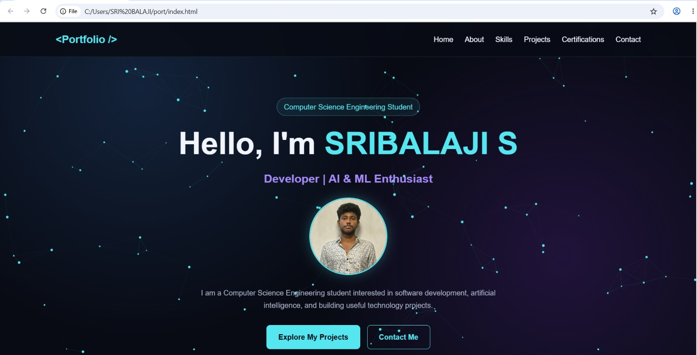
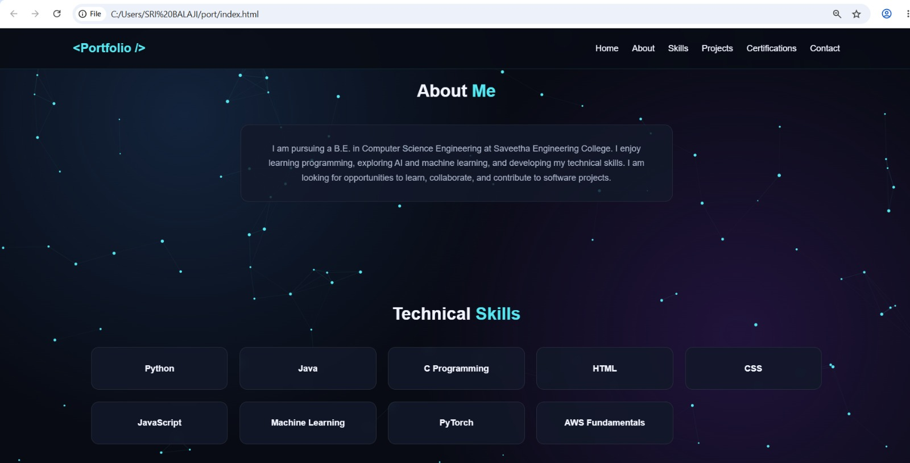

# port# Ex01 Portfolio
## Date:

## AIM
To create a Portfolio using HTML and CSS.

## ALGORITHM
### STEP 1
Create an HTML file (index.html)

### STEP 2
Create a CSS file (style.css)

### STEP 3
Include a navigation bar with links to different sections.

### STEP 4
Add structured sections for introduction, about, projects, and contact details.

### STEP 5
Define global styles for fonts, colors, and layout.

### STEP 6
Style the header, navigation bar, and sections.

### STEP 7
Use Flexbox or CSS Grid for layout design.

### STEP 8
Add hover effects and transitions for interactivity.

### STEP 9
Add Images and Media.

### STEP 10
Use optimized images for a professional look.

### STEP 11
Open the HTML file in a browser to check layout and functionality.

### STEP 12
Fix styling issues and refine content placement.

### STEP 13
Deploy the Portfolio.

### STEP 14
Upload to GitHub Pages for free hosting.

## PROGRAM
```

<!DOCTYPE html>
<html lang="en">
<head>
<meta charset="UTF-8">
<meta name="viewport" content="width=device-width, initial-scale=1.0">
<title>My Portfolio</title>

<style>
* {
    margin: 0;
    padding: 0;
    box-sizing: border-box;
    scroll-behavior: smooth;
    
}
.profile-img {
    width: 170px;
    height: 170px;
    object-fit: cover;
    border-radius: 50%;
    border: 3px solid #55e6f0;
    box-shadow: 0 0 25px rgba(85, 230, 240, 0.3);
    margin-bottom: 25px;
    transition: 0.3s;
}

.profile-img:hover {
    transform: scale(1.07);
    box-shadow: 0 0 35px rgba(85, 230, 240, 0.6);
}
:root {
    --bg: #080b14;
    --card: rgba(18, 24, 42, 0.82);
    --text: #f2f5ff;
    --muted: #a8b1c7;
    --accent: #55e6f0;
    --purple: #a78bfa;
}

body {
    font-family: Arial, sans-serif;
    background: var(--bg);
    color: var(--text);
    line-height: 1.7;
    overflow-x: hidden;
}

/* Interactive background */
#background {
    position: fixed;
    inset: 0;
    width: 100%;
    height: 100%;
    z-index: -1;
    background:
        radial-gradient(circle at 20% 20%, #13233b 0%, transparent 40%),
        radial-gradient(circle at 80% 70%, #20133a 0%, transparent 40%),
        var(--bg);
}

/* Navigation */
nav {
    position: sticky;
    top: 0;
    z-index: 10;
    display: flex;
    justify-content: space-between;
    align-items: center;
    padding: 18px 8%;
    background: rgba(8, 11, 20, 0.88);
    backdrop-filter: blur(14px);
    border-bottom: 1px solid rgba(85, 230, 240, 0.15);
}

.logo {
    font-size: 23px;
    font-weight: bold;
    color: var(--accent);
}

nav ul {
    display: flex;
    gap: 25px;
    list-style: none;
}

nav a {
    color: var(--text);
    text-decoration: none;
    transition: 0.3s;
}

nav a:hover {
    color: var(--accent);
}

/* General sections */
section {
    padding: 90px 10%;
    scroll-margin-top: 65px;
}

h2 {
    text-align: center;
    font-size: 32px;
    margin-bottom: 35px;
}

h2 span,
.highlight {
    color: var(--accent);
}

p {
    color: var(--muted);
}

/* Hero section */
.hero {
    min-height: 88vh;
    display: flex;
    flex-direction: column;
    justify-content: center;
    align-items: center;
    text-align: center;
}

.hero .tag {
    color: var(--accent);
    border: 1px solid rgba(85, 230, 240, 0.4);
    padding: 5px 15px;
    border-radius: 25px;
    margin-bottom: 20px;
    background: rgba(85, 230, 240, 0.07);
}

.hero h1 {
    font-size: clamp(38px, 7vw, 68px);
    line-height: 1.2;
    margin-bottom: 15px;
}

.hero h3 {
    font-size: clamp(18px, 3vw, 25px);
    color: var(--purple);
    margin-bottom: 20px;
}

.hero p {
    max-width: 650px;
    margin-bottom: 30px;
}

.buttons {
    display: flex;
    gap: 15px;
    justify-content: center;
    flex-wrap: wrap;
}

.btn {
    display: inline-block;
    padding: 12px 25px;
    border-radius: 8px;
    text-decoration: none;
    font-weight: bold;
    border: 1px solid var(--accent);
    color: var(--accent);
    transition: 0.3s;
}

.btn.primary {
    background: var(--accent);
    color: #080b14;
}

.btn:hover {
    transform: translateY(-4px);
    box-shadow: 0 0 22px rgba(85, 230, 240, 0.3);
}

/* About */
.about-content {
    max-width: 800px;
    margin: auto;
    text-align: center;
    padding: 30px;
    background: var(--card);
    border: 1px solid rgba(255,255,255,0.08);
    border-radius: 15px;
}

/* Cards */
.grid {
    display: grid;
    grid-template-columns: repeat(auto-fit, minmax(230px, 1fr));
    gap: 22px;
}

.card {
    padding: 25px;
    background: var(--card);
    border: 1px solid rgba(255,255,255,0.09);
    border-radius: 14px;
    transition: 0.3s;
    backdrop-filter: blur(8px);
}

.card:hover {
    transform: translateY(-7px);
    border-color: var(--accent);
    box-shadow: 0 10px 30px rgba(85, 230, 240, 0.08);
}

.card h3 {
    color: var(--accent);
    margin-bottom: 12px;
}

.card p {
    font-size: 14px;
}

.skills .card {
    text-align: center;
    font-weight: bold;
}

/* Contact */
.contact-box {
    max-width: 650px;
    margin: auto;
    text-align: center;
    padding: 30px;
    background: var(--card);
    border-radius: 15px;
    border: 1px solid rgba(255,255,255,0.08);
}

.contact-box p {
    margin: 12px 0;
}

.contact-box a {
    color: var(--accent);
    text-decoration: none;
    overflow-wrap: anywhere;
}

footer {
    text-align: center;
    padding: 25px;
    border-top: 1px solid rgba(255,255,255,0.1);
    color: var(--muted);
}

/* Mobile menu */
.menu-btn {
    display: none;
    font-size: 25px;
    color: var(--accent);
    background: none;
    border: none;
    cursor: pointer;
}

@media (max-width: 700px) {
    nav {
        padding: 15px 5%;
    }

    .menu-btn {
        display: block;
    }

    nav ul {
        display: none;
        position: absolute;
        top: 65px;
        left: 0;
        width: 100%;
        padding: 20px;
        flex-direction: column;
        text-align: center;
        background: #0c1120;
        border-bottom: 1px solid #263047;
    }

    nav ul.show {
        display: flex;
    }

    section {
        padding: 70px 6%;
    }
}
</style>
</head>

<body>

<canvas id="background"></canvas>

<nav>
    <div class="logo">&lt;Portfolio /&gt;</div>

    <button class="menu-btn" id="menuBtn"
        aria-label="Toggle navigation"
        aria-expanded="false">☰</button>

    <ul id="navLinks">
        <li><a href="#home">Home</a></li>
        <li><a href="#about">About</a></li>
        <li><a href="#skills">Skills</a></li>
        <li><a href="#projects">Projects</a></li>
        <li><a href="#certifications">Certifications</a></li>
        <li><a href="#contact">Contact</a></li>
    </ul>
</nav>

<section class="hero" id="home">
    <div class="tag">Computer Science Engineering Student</div>

    <h1>Hello, I'm <span class="highlight">SRIBALAJI S</span></h1>

    <h3>Developer | AI & ML Enthusiast</h3>
    

    <p>
        I am a Computer Science Engineering student interested in
        software development, artificial intelligence, and building
        useful technology projects.
    </p>

    <div class="buttons">
        <a href="#projects" class="btn primary">Explore My Projects</a>
        <a href="#contact" class="btn">Contact Me</a>
    </div>
</section>

<section id="about">
    <h2>About <span>Me</span></h2>

    <div class="about-content">
        <p>
            I am pursuing a B.E. in Computer Science Engineering at
            Saveetha Engineering College. I enjoy learning programming,
            exploring AI and machine learning, and developing my
            technical skills. I am looking for opportunities to learn,
            collaborate, and contribute to software projects.
        </p>
    </div>
    
</section>

<section id="skills" class="skills">
    <h2>Technical <span>Skills</span></h2>

    <div class="grid">
        <div class="card">Python</div>
        <div class="card">Java</div>
        <div class="card">C Programming</div>
        <div class="card">HTML</div>
        <div class="card">CSS</div>
        <div class="card">JavaScript</div>
        <div class="card">Machine Learning</div>
        <div class="card">PyTorch</div>
        <div class="card">AWS Fundamentals</div>
    </div>
</section>

<section id="projects">
    <h2>My <span>Projects</span></h2>

    <div class="grid">
        <div class="card">
            <h3>Blood Donor Recommendation</h3>
            <p>
                A proposed system that explores BiLSTM and deep learning
                to recommend suitable potential blood donors during
                emergency blood requirements.
            </p>
            <p><br><strong>Status:</strong> Project proposal</p>
        </div>

        <div class="card">
            <h3>Machine Learning Project</h3>
            <p>
                Add your machine learning project here. Explain the
                problem, tools used, and what you learned.
            </p>
        </div>

        <div class="card">
            <h3>Web Development Project</h3>
            <p>
                Add another completed project here with a short
                description and its GitHub repository link.
            </p>
        </div>
    </div>
</section>

<section id="certifications">
    <h2><span>Certifications</span></h2>

    <div class="grid">
        
        <div class="card">
            <h3>Open Source with Hugging Face</h3>
        </div>
    </div>
</section>

<section id="contact">
    <h2>Contact <span>Me</span></h2>

    <div class="contact-box">
        <p>Email:
            <a href="mailto:your.email@example.com">
                sribalaji747926@gmail.com
            </a>
        </p>

        <p>GitHub:
            <a href="https://github.com/YOUR-USERNAME"
               target="_blank" rel="noopener noreferrer">
                https://github.com/sribalaji777
            </a>
        </p>
    </div>
</section>

<footer>
    <p>© <span id="year"></span>Sribalaji S. Built with HTML, CSS & JavaScript.</p>
</footer>

<script>
// Mobile navigation
const menuBtn = document.getElementById("menuBtn");
const navLinks = document.getElementById("navLinks");

menuBtn.addEventListener("click", () => {
    const isOpen = navLinks.classList.toggle("show");
    menuBtn.setAttribute("aria-expanded", isOpen);
    menuBtn.textContent = isOpen ? "✕" : "☰";
});

navLinks.querySelectorAll("a").forEach(link => {
    link.addEventListener("click", () => {
        navLinks.classList.remove("show");
        menuBtn.setAttribute("aria-expanded", "false");
        menuBtn.textContent = "☰";
    });
});

// Footer year
document.getElementById("year").textContent =
    new Date().getFullYear();

// Interactive particle background
const canvas = document.getElementById("background");
const ctx = canvas.getContext("2d");

let particles = [];
let width, height;
let animationFrame;
let lastFrame = 0;

const mouse = {
    x: null,
    y: null,
    radius: 130
};

function resizeCanvas() {
    const dpr = Math.min(window.devicePixelRatio || 1, 2);

    width = window.innerWidth;
    height = window.innerHeight;

    canvas.width = width * dpr;
    canvas.height = height * dpr;
    canvas.style.width = width + "px";
    canvas.style.height = height + "px";

    ctx.setTransform(dpr, 0, 0, dpr, 0, 0);

    const count = Math.min(
        110,
        Math.floor((width * height) / 10000)
    );

    particles = Array.from({ length: count }, () => ({
        x: Math.random() * width,
        y: Math.random() * height,
        vx: (Math.random() - 0.5) * 0.65,
        vy: (Math.random() - 0.5) * 0.65,
        size: Math.random() * 2 + 1
    }));
}

function drawParticles(timestamp = 0) {
    animationFrame = requestAnimationFrame(drawParticles);

    // Limit animation to about 40 frames per second.
    if (timestamp - lastFrame < 25) return;
    lastFrame = timestamp;

    ctx.clearRect(0, 0, width, height);

    for (let i = 0; i < particles.length; i++) {
        const p = particles[i];

        p.x += p.vx;
        p.y += p.vy;

        if (p.x < 0 || p.x > width) p.vx *= -1;
        if (p.y < 0 || p.y > height) p.vy *= -1;

        // Mouse interaction
        if (mouse.x !== null && mouse.y !== null) {
            const dx = p.x - mouse.x;
            const dy = p.y - mouse.y;
            const distance = Math.hypot(dx, dy);

            if (distance < mouse.radius && distance > 0) {
                const force = (mouse.radius - distance) / mouse.radius;
                p.x += (dx / distance) * force * 2;
                p.y += (dy / distance) * force * 2;
            }
        }

        // Draw particles
        ctx.beginPath();
        ctx.arc(p.x, p.y, p.size, 0, Math.PI * 2);
        ctx.fillStyle = "#55e6f0";
        ctx.fill();

        // Connect nearby particles
        for (let j = i + 1; j < particles.length; j++) {
            const q = particles[j];
            const distance = Math.hypot(p.x - q.x, p.y - q.y);

            if (distance < 115) {
                ctx.beginPath();
                ctx.moveTo(p.x, p.y);
                ctx.lineTo(q.x, q.y);

                ctx.strokeStyle =
                    `rgba(85, 230, 240, ${0.17 * (1 - distance / 115)})`;

                ctx.lineWidth = 0.7;
                ctx.stroke();
            }
        }
    }
}

window.addEventListener("resize", resizeCanvas);

window.addEventListener("mousemove", event => {
    mouse.x = event.clientX;
    mouse.y = event.clientY;
});

window.addEventListener("mouseout", event => {
    if (!event.relatedTarget) {
        mouse.x = null;
        mouse.y = null;
    }
});

window.addEventListener("touchmove", event => {
    if (event.touches.length) {
        mouse.x = event.touches[0].clientX;
        mouse.y = event.touches[0].clientY;
    }
}, { passive: true });

window.addEventListener("touchend", () => {
    mouse.x = null;
    mouse.y = null;
});

resizeCanvas();
drawParticles();
</script>

</body>
</html>
```

## OUTPUT



## RESULT
The program for creating Portfolio using HTML and CSS is executed successfully.